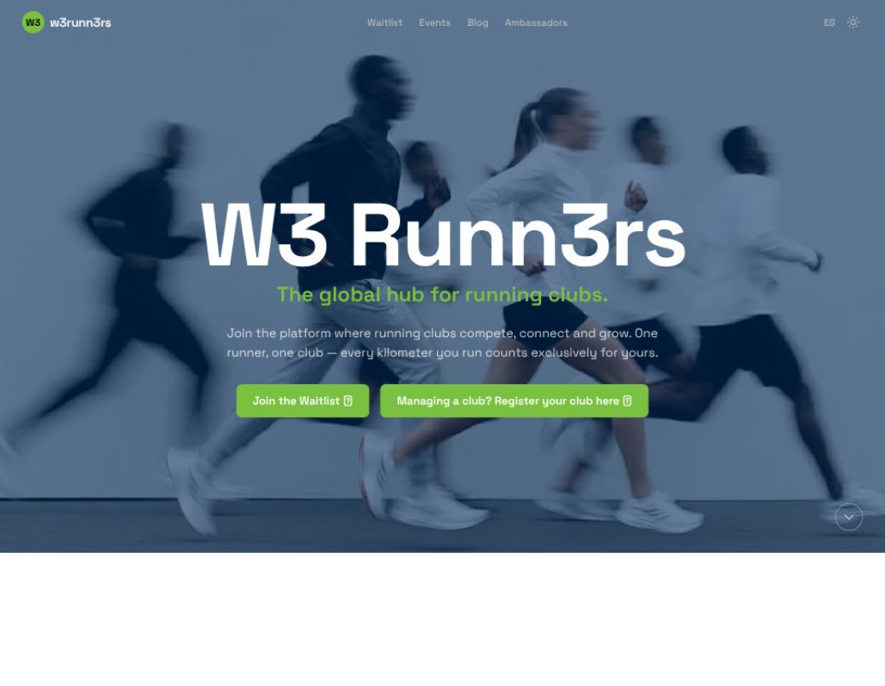

# W3Runn3rs — We Runners

> **Pick your running club, make it count!**
> The global hub for running clubs.



## About

W3Runn3rs is a global hub for running clubs. Runners join **one club**, connect their watch, and every kilometer they run counts for that club on the leaderboards.

- **Website:** [www.w3runn3rs.com](https://www.w3runn3rs.com)
- **App (public beta):** [app.w3runn3rs.com](https://app.w3runn3rs.com)

## What's in this repo

- **Website** — landing, blog, events, ambassadors and legal pages, in English and Spanish.
- **App** — accounts, runner profiles and dashboard, club pages, club leaderboard, and runs synced from Garmin and Polar.

Only runs recorded by a device count for clubs, from the day a runner joins their club.

## Tech stack

Next.js (App Router) · React · TypeScript · Tailwind CSS · next-intl · Better Auth · Prisma · PostgreSQL (Neon) · Vercel · Resend · MDX (blog) · Three.js (hero globe)

## Getting started

Requirements: Node.js 20+ and a PostgreSQL database.

```bash
npm install
cp .env.example .env.local   # then fill in your own values
npx prisma migrate deploy
npm run dev
```

Open [http://localhost:3000](http://localhost:3000). App routes work by path locally (for example `/dashboard`).

`.env.example` lists the variable names only. Never commit real values.

## Project structure

```
app/
  [locale]/     website (/en, /es)
  (app)/        the app
  api/          integrations, webhooks and crons
components/     UI
content/blog/   blog posts (MDX, en/es)
lib/            server logic
messages/       translations (en, es)
prisma/         schema and migrations
```

## Contact

[run@w3runn3rs.com](mailto:run@w3runn3rs.com) · [X](https://x.com/w3runn3rs) · [Instagram](https://instagram.com/w3runn3rs) · [Farcaster](https://farcaster.xyz/w3runn3rs) · [Strava club](https://www.strava.com/clubs/runn3rs)

[Privacy Policy](https://www.w3runn3rs.com/en/privacy-policy) · [Terms of Service](https://www.w3runn3rs.com/en/terms-of-service)

---

<p align="center">
  <strong>Pick your running club, make it count!</strong><br/>
  © 2026 w3runn3rs. All rights reserved.
</p>
